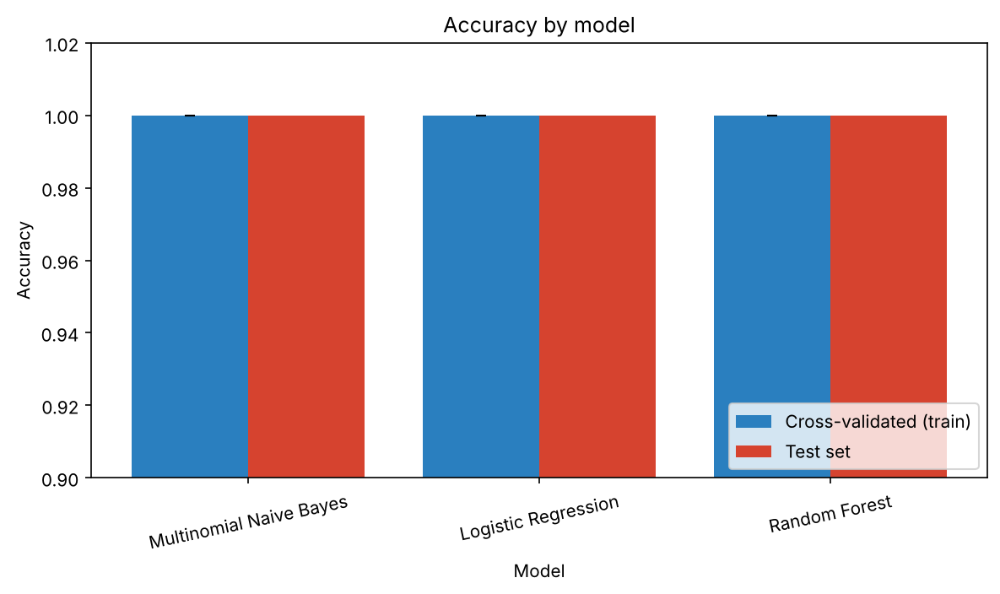
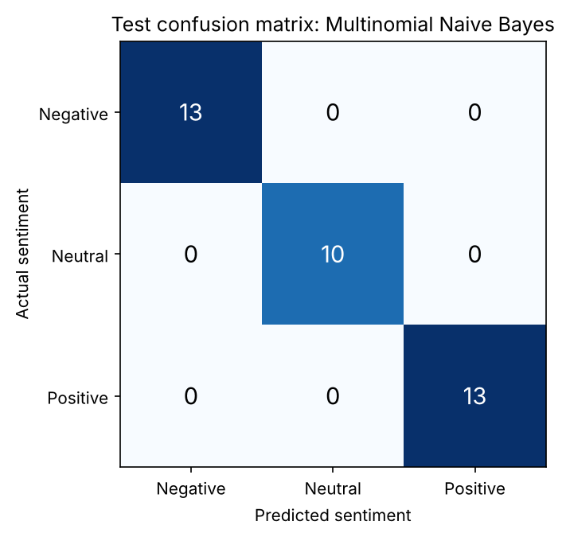
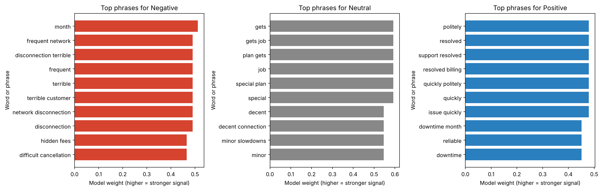

# Project Report: Advanced Data Analysis Using Natural Language Processing (NLP)

*This report is generated by `notebooks/nlp_sentiment_analysis.ipynb`; every number comes from that run.*

> **Important caution:** this run used the bundled synthetic dataset. Its reviews are built from a small set of template sentences, so the task is very easy and the scores say little about how the models would perform on real, messy text. Run the notebook with `USE_REAL_DATA = True` and internet access to evaluate on real reviews.

> **Near-perfect accuracy is a warning sign, not a success.** It usually means the data is too easy or repetitive. Duplicate texts were removed before splitting to prevent leakage.

## 1. Chosen technique: NLP with TF-IDF and supervised sentiment classification
Natural language processing lets a computer extract structured information from free text. Here, each review is converted into numbers with **TF-IDF** (term frequency-inverse document frequency): a word gets a high weight when it is frequent in a review but rare across all reviews, so distinctive words count more than common ones. We use single words and word pairs (**unigrams and bigrams**), so that phrases such as "not good" are captured. A supervised classifier then learns to predict the sentiment label from these numbers.

## 2. Dataset and application
- **Dataset:** Bundled customer reviews (synthetic). The bundled `customer_reviews_nlp.csv`: telecom-style customer reviews labelled Positive, Neutral or Negative. The text is generated from a small set of template sentences, so it is much easier than real reviews.
- **Size:** 1,200 reviews loaded; 1,024 duplicate texts removed; **176** reviews used.
- **Classes:**
- **Positive:** 64 reviews
- **Negative:** 64 reviews
- **Neutral:** 48 reviews
- **Application:** companies receive thousands of reviews and support messages. Automatic sentiment analysis can flag dissatisfied customers early so retention teams can respond, and shows which phrases signal dissatisfaction.

## 3. Methodology
1. **Quality checks and de-duplication:** missing values dropped and duplicate texts removed **before** splitting, so no review appears in both the training and the test set.
2. **Text cleaning:** lowercase, HTML tags and punctuation removed, whitespace normalised.
3. **Split:** stratified 80/20 (140 training, 36 test reviews, `random_state=42`).
4. **TF-IDF inside a pipeline:** English stop words removed, unigrams and bigrams, at most 5,000 features, minimum 2 reviews per term. The vocabulary is learned from training text only, which prevents data leakage.
5. **Models:** Multinomial Naive Bayes, Logistic Regression and Random Forest.
6. **Evaluation:** 5-fold stratified cross-validation on the training set, then a single evaluation on the test set. Accuracy plus macro-averaged precision, recall and F1.

## 4. Results
### 4.1 Model comparison
| Model | CV accuracy | Test accuracy | Macro precision | Macro recall | Macro F1 |
|---|---|---|---|---|---|
| Multinomial Naive Bayes | 1.000 +/- 0.000 | 1.000 | 1.000 | 1.000 | 1.000 |
| Logistic Regression | 1.000 +/- 0.000 | 1.000 | 1.000 | 1.000 | 1.000 |
| Random Forest | 1.000 +/- 0.000 | 1.000 | 1.000 | 1.000 | 1.000 |



The best model by cross-validated accuracy is **Multinomial Naive Bayes**: 100.0% in cross-validation and **100.0% on the test set**. The gap between the two is 0.0 percentage points, so the cross-validated estimate was close to the test result.

### 4.2 Best model in detail
```
              precision    recall  f1-score   support

    Negative       1.00      1.00      1.00        13
     Neutral       1.00      1.00      1.00        10
    Positive       1.00      1.00      1.00        13

    accuracy                           1.00        36
   macro avg       1.00      1.00      1.00        36
weighted avg       1.00      1.00      1.00        36

```


0 of 36 test reviews were misclassified. Examples:

- No misclassified test reviews.

### 4.3 Which phrases drive the predictions (Logistic Regression weights)
| Class | Top phrases (strongest first) |
|---|---|
| Negative | *month*, *frequent network*, *disconnection terrible*, *frequent*, *terrible*, *terrible customer*, *network disconnection*, *disconnection* |
| Neutral | *gets*, *gets job*, *plan gets*, *job*, *special plan*, *special*, *decent*, *decent connection* |
| Positive | *politely*, *resolved*, *support resolved*, *resolved billing*, *quickly politely*, *quickly*, *issue quickly*, *downtime month* |



## 5. Insights
- The best model reads the sentiment of 100.0% of unseen reviews correctly, compared with 36.4% for always guessing the most common class.
- The phrases above are the clearest signals of each sentiment. A business could track how often they appear to monitor satisfaction over time.
- Automatic classification can triage a large stream of reviews so people read the unhappy ones first. Misclassified examples show where a human check is still needed.

## 6. Limitations
- The bundled data is synthetic, so conclusions about real customers cannot be drawn from it.
- TF-IDF treats text as a bag of words and cannot fully handle sarcasm, negation spread over several words or context; transformer-based models handle these better.
- Only 36 reviews are in the test set, so accuracy differences of about one percentage point between models are not meaningful.
- Phrase weights show association with a label, not the reason a customer was unhappy.

## 7. How to reproduce
```bash
pip install -r requirements.txt
jupyter notebook notebooks/nlp_sentiment_analysis.ipynb   # Run All
```
In Google Colab: upload the notebook and choose **Runtime > Run all**. The run writes this report to `reports/advanced_analysis_report.md` and the charts to `images/`.
